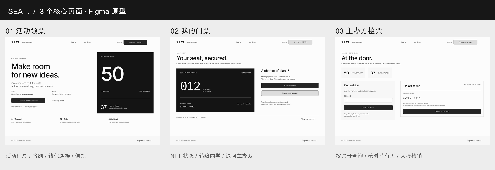

# Seminar Ticket DApp

COMP7610 Introduction to Web3 and Blockchain — Final Project

**English summary:** A ticketing DApp for a free campus seminar with 50 seats. Students connect MetaMask to claim, transfer or return an ERC-721 ticket on Sepolia. The organizer checks in the current holder once; the used NFT remains as a non-transferable souvenir. The project includes three React pages, ethers.js integration, a deployed Solidity contract, 43 recorded passing local checks, and a browser walkthrough of five successful transactions covering four operation types.

## 项目介绍

本项目以免费校园讲座为场景，在教学示例的 NFT 领取流程上增加座位容量、门票转让、退票复用和一次性入场核销。前端通过 ethers.js 读取链上状态，由 MetaMask 签署交易，合约统一执行资格、容量与权限规则。

正式应用包含 Event、My ticket 和 Organizer check-in 三个页面，已接入 Sepolia 上部署的合约。领取、转让、核销和退票的浏览器操作已完成，交易记录见下文。连接钱包、转让和退票通过弹窗完成；纪念票是 My ticket 的一种状态，不是第四个页面。

## 已实现功能

| 操作 | 页面 | 规则与结果 |
| --- | --- | --- |
| 领取 | Event · `#claim` | 有剩余座位、没有有效票且尚未入场的合资格地址可以领取；优先复用退回的 NFT，否则铸造新票。 |
| 转让 | My ticket · `#ticket` | 当前持有人可将未核销票转给另一合资格地址；票号不变，入场资格随所有权转移，余票不变。转出者未入场时可以再次领票。 |
| 退票 | My ticket · `#ticket` | 未核销票退回组织者库存，释放一个名额，后续领取可复用该票号。门票免费，没有 ETH 退款。 |
| 核销 | Organizer check-in · `#door` | 只有部署者钱包可按票号核销当前持有人；核销后保留纪念 NFT，禁止转让、退票和重复核销。 |

每个地址最多持有一张有效票；已入场地址不能再次领取或接收门票。组织者地址负责库存和核销，不参与学生领票。退回票按后进先出顺序复用。

容量始终满足：

```text
remaining + activeCount + usedCount = 50
```

核销将有效票转为已使用票，不重新开放座位。标准 ERC-721 转账入口同样执行业务规则；接收合约回调前完成状态更新，并对相关入口提供重入保护。

## 快速启动

### 环境准备

- Node.js：建议使用项目记录的验证版本 **22.23.2**，并使用随附的 npm。
- 安装 MetaMask 的浏览器，钱包网络选择 **Sepolia**。
- 执行写操作的钱包需要少量 Sepolia 测试 ETH 支付 gas；门票本身免费。

在项目根目录执行：

```bash
node -v
npm ci
```

复制环境变量示例。在 Windows PowerShell 中执行：

```powershell
Copy-Item .env.example .env
```

在 macOS / Linux 中执行：

```bash
cp .env.example .env
```

**先编辑 `.env`，将占位地址替换为以下内容，再启动应用：**

```dotenv
VITE_CONTRACT_ADDRESS=0x273d4F66420C2Bac602bdcfe4A5Bc395B1dC2dE3
```

```bash
npm run dev
```

打开终端显示的地址，通常是 `http://localhost:5173`。顶部可进入 Event 和 My ticket，页脚 Organizer access 可进入核销页面。修改 `.env` 后需要重启 Vite。

使用现有合约运行正式 DApp **无需重新部署，也无需启动部署辅助工具**。普通钱包可以体验学生功能，只有下文列出的组织者钱包可以确认核销。

### 常用命令

| 命令 | 用途 |
| --- | --- |
| `npm run dev` | 启动正式 DApp 开发服务器。 |
| `npm run build` | 生成生产构建 `dist/`。 |
| `npm run preview` | 预览已经生成的生产构建。 |
| `npm run lint` | 使用 Oxlint 检查源码。 |
| `npm run compile:contract` | 编译 Solidity，生成合约产物并更新前端 ABI；不部署。 |
| `npm run test:contract` | 运行本地合约测试。 |
| `npm run test:deployment` | 运行部署准备与验证工具测试。 |
| `npm run test:deployment-preview` | 运行部署辅助工具测试。 |
| `npm run prepare:deployment` | 生成标准编译输入、ABI、部署字节码与校验清单；不发送交易。 |
| `npm run verify:deployment -- --help` | 查看部署只读核验工具的参数。 |
| `npm run preview:deployment` | 启动可选的部署与验收辅助工具。 |

## 技术栈与实现

版本以本次提交的 `package-lock.json` 为准。

| 层 | 技术与版本 |
| --- | --- |
| 前端 | React / React DOM 19.3.0 |
| 构建 | Vite 8.3.0 |
| 区块链接入 | ethers 6.17.0 |
| 合约 | Solidity / solc 0.8.30；OpenZeppelin Contracts 5.6.1 |
| 本地验证 | Hardhat 2.28.6 提供本地网络；Node.js `node:test` 运行测试 |
| 编译配置 | Optimizer 开启，200 runs；EVM Cancun |
| 钱包与网络 | MetaMask；Sepolia，链 ID `11155111`（`0xaa36a7`） |

只读查询使用 `JsonRpcProvider` 和公共 Sepolia RPC，不需要钱包签名；写操作使用 `BrowserProvider` 获取 signer，经过 MetaMask 确认后提交。钱包模块等待交易回执后返回交易哈希。

前端提供错误网络、拒绝签名、重复领票和非组织者核销提示。组织者页面保留成功核销的哈希与 Etherscan 链接；如果后续状态查询失败，仍保留成功结果并提示重新查询。

| 路径 | 内容 |
| --- | --- |
| `contracts/SeminarTickets.sol` | 领取、转让、退票复用、核销、容量和资格规则。 |
| `src/config/contract.js` | 环境变量合约地址、链 ID、ABI 和浏览器链接配置。 |
| `src/config/SeminarTickets.abi.json` | 编译生成的完整 ABI，包含事件和自定义错误。 |
| `src/wallet/ethereum.js` | 钱包连接、网络切换及四类业务交易。 |
| `src/chain/read.js` | 容量、有效票、纪念票、所有者、状态及活动记录查询。 |
| `src/pages/ClaimPage.jsx` | 活动信息、余票和领票入口。 |
| `src/pages/TicketPage.jsx` | 当前门票、转让、退票和已核销纪念票。 |
| `src/pages/DoorPage.jsx` | 按票号查询、组织者核销和成功交易链接。 |
| `src/ui/` | 共用会话、状态提示、地址格式和错误消息。 |
| `src/App.jsx` | 三个页面的 hash 路由和共用钱包弹窗。 |
| `test/` | 合约、部署工具及部署辅助工具测试。 |
| `scripts/` | 编译、部署准备、只读核验及辅助工具。 |
| `docs/evidence/` | 早期部署及 #1 领取、退票、重领的链上记录。 |
| `docs/demo/` | 早期设计原型截图与模拟操作录屏。 |

## 测试结果

项目记录的 2026-10-24 本地验证共 **43 项通过**。合约用例包含按不同 ERC-721 入口展开的参数化测试。

| 测试套件 | 通过数量 | 主要覆盖 |
| --- | ---: | --- |
| `test/SeminarTickets.test.mjs` | 32 | 容量、退票复用、权限、标准转账、接收合约回调、重入及失败回滚。 |
| `test/DeploymentTools.test.mjs` | 8 | 编译与部署产物、代码和状态匹配、错误输入拒绝。 |
| `test/DeploymentPreview.test.mjs` | 3 | 账户和网络限制、重复发送保护、本地 HTTP 服务限制。 |
| **合计** | **43** | |

可分别复现：

```bash
npm run test:contract
npm run test:deployment
npm run test:deployment-preview
npm run build
npm run lint
```

上述本地测试不需要 MetaMask 或 Sepolia ETH。既有报告记录生产构建成功，lint 无错误、存在三条 React 警告，构建提示 JavaScript chunk 大于 500 kB。自动化验证与下述浏览器操作记录分别覆盖合约规则和实际用户流程。

## Sepolia 部署与操作记录

### 部署

- 合约：[0x273d4F66420C2Bac602bdcfe4A5Bc395B1dC2dE3](https://sepolia.etherscan.io/address/0x273d4F66420C2Bac602bdcfe4A5Bc395B1dC2dE3)
- 组织者：`0x5bA8D6f1dCDb101D6a4EF905788CEBC048b2b133`
- [部署交易](https://sepolia.etherscan.io/tx/0xab973e92f52498745b6add116d73b5ea1901cd94df05d649f6027e17303bd6d9)：区块 `11984380`，回执成功。
- 部署方式：本地部署辅助工具与 MetaMask。
- [初始核验](docs/evidence/sepolia-initial.json)：固定区块 `11984383`，初始余票 50，已铸造 0。
- [早期生命周期最终核验](docs/evidence/sepolia-final.json)：固定区块 `11984520`，核对运行时代码、创建字节码、元数据、组织者和状态。该记录是早期快照，不是当前实时状态。

固定区块字节码核验与 Etherscan 公开源码验证是不同事项。

### 退票后复用同一 NFT

[完整生命周期记录](docs/evidence/sepolia-lifecycle.json)记录了早期测试钱包对 #1 的三笔成功交易。

| 操作 | 票号 | 剩余座位 | 已铸造数量 | 交易 |
| --- | --- | ---: | ---: | --- |
| 领取 | #1 | 49 | 1 | [Etherscan](https://sepolia.etherscan.io/tx/0x25c0d688a5e34c4332bc641a3f9a91430d7fc109f370892bf7820f7a53797175) |
| 退回 | #1 | 50 | 1 | [Etherscan](https://sepolia.etherscan.io/tx/0xf3937e97ac65e42508ab7b48c6ef64477b47a567963a7eca4f6eecb419d02fac) |
| 再次领取 | #1 | 49 | 1 | [Etherscan](https://sepolia.etherscan.io/tx/0x82e7900c5f5ea40b203d0b615091b8e16f0906d163663028b54f37a5e6717386) |

### 正式前端浏览器操作

操作记录由 Wang Yukai 提供，使用以下钱包；Student A / B 是测试角色，不代表成员身份。

| 角色 | 地址 |
| --- | --- |
| Student A | `0xC9C2bE877D01Dc7a58bf3768c7da29E60f882bfd` |
| Student B | `0xD7C38095FB3967Ca44A70AF423B82Eb31a0ce9Be` |
| Organizer | `0x5bA8D6f1dCDb101D6a4EF905788CEBC048b2b133` |

五笔成功交易覆盖领取、转让、核销、退票四类操作。对应前端与 Etherscan 截图见小组报告的附录 B。

| 顺序 | 操作 | 记录结果 | 区块 | 交易 |
| --- | --- | --- | --- | --- |
| 1 | A 领取 #3 | #3 从组织者库存重新发放给 A，并非新铸造。 | 12020310 | [Etherscan](https://sepolia.etherscan.io/tx/0x17664386a55ae84c48df826538dc8e320672477d016b6224ebb49e83c62b144f) |
| 2 | A 将 #3 转给 B | 票号不变；B 的页面显示有效票。 | 12020322 | [Etherscan](https://sepolia.etherscan.io/tx/0xc9b4eb09c4410757e838cc15c4116124d958cbc03f8bc7de8a946f2fcb1c905e) |
| 3 | Organizer 核销 #3 | B 保留纪念 NFT，转让与退票按钮禁用。 | 12020333 | [Etherscan](https://sepolia.etherscan.io/tx/0x82b90e47aa75d7ce545a5c2f2269310aebe5e5ec56816a9f31dd71c7131647ee) |
| 4 | A 领取 #4 | 新票从零地址铸造给 A。 | 12020349 | [Etherscan](https://sepolia.etherscan.io/tx/0x09832ef69fb01a7cba0fb1d618bf63abdf368a074241798c8a932139148f46a6) |
| 5 | A 退回 #4 | NFT 回到组织者库存。 | 12020353 | [Etherscan](https://sepolia.etherscan.io/tx/0x88a8ea30f3e430c9e436226b3c05c5ec984809071c4eaae7bb010d56ee782ec0) |

#3 已经核销，不能用于退票，因此另领 #4 演示退票。上述 #3/#4 记录与早期 #1 生命周期是两个独立测试阶段。

## 设计原型与部署辅助工具

### 早期界面设计

- [Figma 设计稿](https://www.figma.com/design/heOrdlDjJbrbyY5WagefQH/COMP7610-%C2%B7-Seminar-Tickets-%C2%B7-Monochrome?node-id=0-1&t=IKL0Dn3s5v6NEcxV-1)
- [原型操作录屏](docs/demo/DAPP-原型操作演示.mp4)
- [活动领票](docs/demo/01-活动领票.png)、[我的门票](docs/demo/02-我的门票.png)、[主办方检票](docs/demo/03-主办方检票.png)、[纪念票状态](docs/demo/04-已核销纪念票.png)



`docs/demo/` 中的图片和视频展示早期 Figma 模拟交互，数值和地址是演示数据，不作为真实链上操作证据。正式 DApp 位于 `src/`，浏览器交易记录列于上一节。

### 可选部署辅助工具

`scripts/deployment-preview/` 用于部署及领取、退票、重领验收，通过 `npm run preview:deployment` 启动，默认地址为 `http://127.0.0.1:4174`。它与 `npm run dev` 启动的正式应用分开。

该工具保留本次验收指定账户的限制，不是供任意钱包体验的通用页面。其写操作通过 MetaMask 提交 Sepolia 交易。一般运行与评审直接使用正式 DApp 即可。

部署细节见 [部署与交接文档](docs/05-成员2部署与交接.md)。

## 已知限制

- 限制按地址生效，无法阻止同一个人使用多个钱包；线下身份与实际到场仍由组织者核验。
- 组织者地址和 50 座容量固定，没有紧急暂停、组织者轮换、整场活动取消或合约升级机制。
- 活动日期和地点由前端展示；合约没有按活动时间自动关闭领取或核销的逻辑。
- 前端依赖钱包和公共 RPC 的可用性。只读查询使用固定 Sepolia RPC，事件扫描起点与本次部署对应。
- 不包含 NFT 图片和逐票元数据。核销后的纪念 NFT 表示链上状态，不保证钱包展示收藏品图片。
- 转让和退票后，原持有人可能进入无票页面；交易结果仍可通过上面的 Etherscan 记录核对。

## 小组贡献

所有成员共同讨论背景、场景、规则和用户流程，以下是主要职责。

| 成员 | UID | 主要贡献 |
| --- | --- | --- |
| Dong Yiyang | 3036842698 | 合约生命周期、资格和容量规则、ABI、本地测试、部署工具、Sepolia 部署和核验记录。 |
| Lu Shijie | 3036841228 | 三个正式页面、共用钱包和会话集成、链上读写接入、加载及空状态。 |
| Wang Yukai | 3033113371 | 测试钱包准备、领取/转让/核销/退票操作、交易核对、操作 Word 和截图。 |
| Zhang Yidan | 3036841668 | 核销成功链接、拒绝签名/错误网络/重复领票/非授权核销等界面反馈。 |
| Zhang Ke | 3036866280 | 整理背景与流程、汇总实现和测试材料、报告协调、分工及参考资料和交易证据整理。 |

## 相关资料

- [合约说明](contracts/README.md)
- [票务流程设计](docs/03-转让退票与票务流程.md)
- [页面与交互设计](docs/04-页面与交互设计.md)
- [合约设计与实现材料](docs/report/成员2-合约设计与实现.md)
- [课程教学示例](https://github.com/jzjzzzzzzz/nft-ticket-dapp)

`docs/` 中保留部分早期设计和任务分配记录，其中的“待实现”描述属于当时的开发阶段。当前功能状态以本 README、提交源码和小组最终报告为准。
