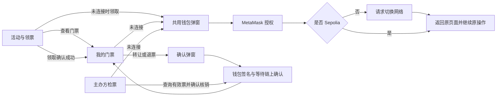

# 页面与交互设计

应用安排 **3 个业务页面**：活动与领票、我的门票、主办方检票。钱包连接是全局弹窗，转让和退票是确认弹窗；无票、交易等待和已核销是界面状态，不增加页面数量。这是小组产品设计，作业 PDF 并未要求特定页面数。

[Figma 黑白灰设计稿](https://www.figma.com/design/heOrdlDjJbrbyY5WagefQH?node-id=5-19) 使用可编辑文字、布局和组件。第一张 Figma 画布保存三个主要页面、状态稿和弹窗稿；第二张画布用于原型连接。画面中的剩余座位、票号、地址和活动文案均为演示数据，实际网页必须从合约读取。日期和地点暂显示待公布。

[可点击原型画布](https://www.figma.com/design/heOrdlDjJbrbyY5WagefQH?node-id=13-872) 中已连接领取、转让、退票、核销、主要取消与返回路径，并设置三条演示入口。点击 Present 后从左侧选择 `01 Student · connect and claim`、`02 Student · transfer or return` 或 `03 Organizer · look up and check in`。等待画面按延时自动进入结果；输入框、钱包授权和链上交易均为静态模拟。满座、交易失败、纪念票等另有状态稿，未为每一种异常组合制作可点击分支。

## 页面职责

| 页面与路由 | 核心内容 | 主要入口和下一步 |
| --- | --- | --- |
| 活动与领票 `#claim` | 活动介绍、50 个总座位、实时余票、领取资格、免费票与测试网手续费说明 | 未连接点领取 → 钱包弹窗；连接后领取 → 等待交易 → 我的门票 |
| 我的门票 `#ticket` | 当前 NFT 票号、持有人、有效或已核销状态、转让、退票、最近交易链接 | 有效票 → 转让或退票弹窗；无票 → 返回活动领票；已核销 → 纪念票 |
| 主办方检票 `#door` | 部署者权限、票号查询、当前持有人和票状态、核销结果 | 部署者查询有效票 → 确认核销 → 已核销结果；其他钱包 → 权限提示 |

顶部放品牌、Event、My ticket 和钱包控件；底部提供 Organizer access。公开活动页面可在未连接钱包时浏览。页面刷新保留路由，并重新读取账户与合约状态；直接访问受保护页面也要有连接或权限提示。

刷新「我的门票」时先查 `activeTicketOf(account)`；没有有效票则查 `enteredTicketOf(account)`，再按票号读取所有者与状态。核销会清空有效票号，纪念票不能只依赖页面内存显示。

## 为什么钱包用弹窗

用户从领票、我的门票或主办方页面都可能需要连接。统一弹窗可保留原页面与原意图，连接后直接继续。钱包本身没有独立的业务内容，单独做第四页会增加往返。

## 钱包与账户交互

1. 打开弹窗时记录返回路由与待执行意图，例如 `claim`、`viewTicket` 或 `organizerAccess`。
2. 点击 Continue with MetaMask 后调用连接。网页不填写助记词或私钥；钱包账户授权由 MetaMask 展示。
3. 没有安装钱包时显示安装提示并保留取消入口。用户拒绝连接时保留原页面，可重试。
4. 连接后检查链 ID；不是 Sepolia 时显示切换网络弹窗。拒绝切换时仍可浏览活动，链上写操作不可用。
5. 检查当前地址的有效票和入场记录。若原意图是领取，只有重新确认资格后才能请求交易签名；若原意图是查看门票，回到 `#ticket`。主办方入口还要比较 `organizer()`。
6. 钱包控件显示缩略地址，详情弹窗可查看完整地址、网络和断开连接。断开仅结束网页会话，NFT 仍在钱包中。
7. 账户或网络改变时清空旧账户展示并重新查询；已经提交的交易按交易哈希继续追踪，不能把 A 的票当作 B 的票展示。

## 四条主要操作链路

| 操作 | 按钮到结果的连接 | 成功后的更新 |
| --- | --- | --- |
| 领取 | 活动页 → 资格检查 → MetaMask 签名 → 等待 → 我的门票有效状态 | 查询票号、所有者和票状态；余票减一 |
| 转让 | 我的门票 → 输入完整接收地址 → 校验 → 确认转让 → 签名与等待 → 无有效票状态 | A 清除有效票；B 刷新或连接后看到该票；余票不变 |
| 退票 | 我的门票 → 显示部署者地址与资格取消说明 → 确认退票 → 签名与等待 → 无有效票状态 | NFT 所有者改为部署者，余票加一；返回活动可再领取 |
| 核销 | 主办方页 → 输入票号 → 查询当前持有人与状态 → 现场核验 → 确认核销 → 签名与等待 → 已核销结果 | 持有人刷新后看到纪念票；禁止再转让、退票或重复核销 |

转让地址必须有效、非零、不是自己、主办方或合约地址；接收者不能已有有效票或已经入场。确认时显示完整地址，不能只展示省略地址。输入错误或资格不符时，在字段附近说明原因并禁用确认。

退票目的地固定读取 `organizer()`，不让用户自行填写。文案明确「退回 NFT 并取消入场资格」，票免费，所以没有退款。核销确认应显示票号和完整持有人地址；钱包只能证明链上归属，主办方仍需线下核验到场者。

## 页面状态与交易反馈

| 场景 | 界面行为 |
| --- | --- |
| 活动未连接 | 公开显示活动与余票，主按钮 Connect to claim a seat |
| 活动已连接且有资格 | 主按钮 Claim a free seat |
| 已持有效票 | 领取按钮改为 View my ticket，避免重复领取 |
| 余票为零 | Sold out，禁用领取；退票释放后刷新恢复 |
| 已入场地址 | 提示已核销，不能重新领取或接收票 |
| 我的门票未连接 | 连接提示与连接按钮 |
| 初次无票、已转出、已退票 | 同一无有效票布局，分别解释原因，提供返回活动和最近交易 |
| 有效票 | 显示 NFT 卡片，转让和退票可用 |
| 已核销纪念票 | 显示 Checked in，转让与退票禁用，保留核销交易记录 |
| 主办方未查询 | 输入票号，结果区等待查询 |
| 主办方查询无结果 | Ticket not found，允许修改票号重试 |
| 普通同学访问主办方 | Organizer wallet required；不能发送核销交易 |
| 钱包等待签名 | 等待用户在 MetaMask 确认；同一操作按钮禁用 |
| 交易已提交 | 显示哈希、Etherscan 链接和等待确认；关闭提示不取消交易 |
| 用户拒绝或交易失败 | 保留原票与输入内容，显示原因并提供重试；不要提前扣除余票 |
| 确认成功 | 重新读取链上状态后展示结果，不只修改本地计数 |

合约始终是资格和权限的最终判断来源。前端的预检查与禁用按钮负责减少无效操作，不能替代合约约束。合约状态规则沿用 `docs/03`。

## 视觉与组件

- 白色背景、近黑文字和按钮，浅灰面板与分隔线。用留白、字号和对齐建立层次。
- 主页面为 1440 像素桌面稿，方便课程视频演示。活动页用大标题和黑色 50 座位面板；门票页用黑色 NFT 票卡；主办方页左右安排查询与结果。
- 英文产品界面方便英文视频展示；画布说明与本地文档使用中文。实际团队可统一调整文案。
- 共用页头、按钮、输入框、门票卡、弹窗和交易提示。有效与已核销门票使用同一组件的不同状态。
- 数字、钱包地址和票号使用等宽字体；正文与按钮使用 Inter。真实地址在确认操作时完整展示。
- 移动端开发时两栏改为单栏，按钮全宽，地址换行，弹窗适配屏宽；本次 Figma 主要交付桌面稿。

## 实现与分工

当前页面源码仍只有 `ClaimPage.jsx`、`DoorPage.jsx` 和两个 hash 路由。合约 `SeminarTickets.sol` 和完整 ABI 已实现，已部署 Sepolia 并通过初始核验；正式钱包、只读查询和页面仍待接入。成员 2 的本地部署辅助页供开发验收使用，Figma 设计仍是原型。

| 位置 | 下一步实现 | 负责人 |
| --- | --- | --- |
| `src/App.jsx` | 增加 `#ticket`，共享账户、网络、连接意图和弹窗状态 | 成员 4，与成员 3 同步 |
| `src/pages/ClaimPage.jsx` | 活动、余票与领取资格 | 成员 4 |
| `src/pages/TicketPage.jsx` 待新建 | 有效票、无票、纪念票和操作入口 | 成员 4 |
| `src/pages/DoorPage.jsx` | 部署者权限、票号查询、核销结果 | 成员 4 |
| `src/ui/` | 钱包、转让、退票弹窗与共用交易状态组件 | 成员 4 |
| `src/wallet/ethereum.js` | 钱包连接、网络变化、四种交易及交易哈希 | 成员 3 |
| `src/chain/read.js` | 当前有效票、纪念票号、所有者、票状态、入场记录、余票与部署者 | 成员 5 |
| `contracts/` 与 ABI | 已部署 Sepolia；地址见 README，继续业务验收与页面联调 | 成员 2，成员 1 集成 |

## 联调验收

1. 未连接钱包直接打开活动页；从领取和我的门票分别连接，连接后回到正确页面。
2. 使用错误网络和拒绝授权，确认页面能继续操作和重试。
3. A 领取成功自动进入有效门票页；转给 B 后 A 无票，B 查询看到同一票号，余票不变。
4. C 退票后余票加一；D 再领取复用该票号。
5. 普通钱包访问主办方页面无核销权限；部署者查询 B 的票并核销一次。
6. B 的票显示纪念状态，不能再次转让、退票或核销；签名拒绝与链上失败不会提前改变票或余票。
7. 成功结果能打开与钱包一致的真实 Sepolia 交易链接；画面演示数据替换为合约数据。
