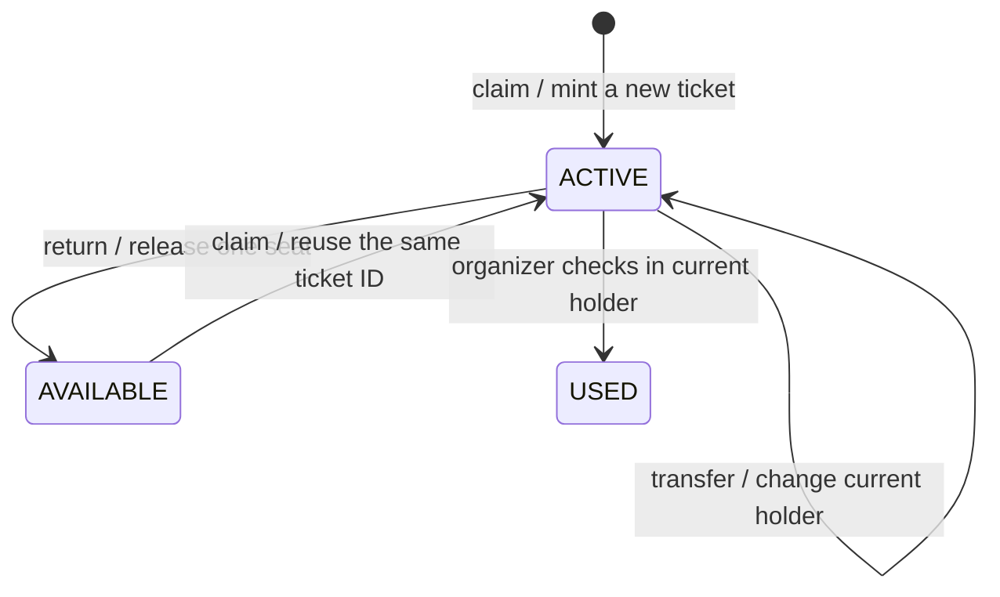

# 成员 2：合约设计与实现报告材料

部署证据日期：2026-10-24；接入进度更新：2026-11-03。以下英文内容可并入小组报告的 **Design** 与 **Implementation** 章节；验证和限制可以作为 Implementation 的小节。合约、本地测试、Sepolia 部署、领取 → 退票 → 同票号重领及最终链上核验已完成；姓名 / UID 按本人要求留空。正式钱包、查询和三个页面已有接入，完整网页验收证据与最终报告仍需小组汇总，这不是最终报告 PDF。

## Design — Smart contract

### Purpose and scope

`SeminarTickets` represents admission rights to one free seminar with a fixed capacity of 50 seats. Each NFT has a unique ticket ID and one current owner. The contract supports claiming, transferring, returning and checking in a ticket. Unlike the teaching example, which only records whether an address has minted once, this design separates a ticket's owner, its lifecycle state and an address's admission history. A student may claim again after transferring or returning an unused ticket, but an address that has checked in cannot claim or receive another ticket.

The contract is the authority for ownership, eligibility, seat accounting and check-in permissions. The React browser application accesses these rules through ethers.js, using a wallet signer for transactions and a public RPC for reads. Hiding a button in the interface is insufficient: the same rules apply when someone calls the contract directly or uses a standard ERC-721 transfer function.

### Roles and ticket lifecycle

The deployer becomes the immutable `organizer`. Only that address can check in a ticket, and returned NFTs are held at that address until claimed again. The organizer cannot claim an admission ticket or transfer returned inventory outside the claim process. Other eligible addresses can claim and hold tickets. The convenience transfer and return functions require the current owner; standard ERC-721 transfer functions also accept properly approved operators.

| State | Value | Owner and permitted actions |
| --- | --- | --- |
| `AVAILABLE` | `0` | An already minted, returned ticket belongs to the organizer and can be reissued by `claim()`. |
| `ACTIVE` | `1` | The student holds an admission right; the ticket can be transferred, returned or checked in. |
| `USED` | `2` | The checked-in student keeps the NFT as a souvenir; it cannot be transferred, returned or checked in again. |



An unminted seat is not an NFT in the `AVAILABLE` state. Queries for nonexistent ticket IDs revert. Ticket IDs start at 1, so 0 can identify the absence of a ticket in address lookups.

`activeTicketOf(account)` records the address's current admission ticket. Check-in clears this value and writes the same ID to `enteredTicketOf(account)`. `hasEntered(account)` derives its result from whether the latter value is nonzero. This separate souvenir lookup lets the application recover a checked-in ticket after a page refresh; neither the active-ticket lookup nor the ERC-721 balance alone can identify admission eligibility.

### Capacity and return reuse

The contract maintains the following relation:

```text
remaining() + activeCount() + usedCount() = seatCap() = 50
```

Claiming consumes one available seat. Transferring changes the holder without changing capacity. Returning an active ticket decreases the active count and releases one seat. Check-in moves one ticket from the active count to the used count, so entry never reopens capacity. `remaining()` is calculated from the two counts instead of maintained as a separate stored counter.

Returned ticket IDs enter a last-in, first-out pool. A later claim reuses a returned NFT before minting a new one, preserving its ticket ID. `totalMinted()` never exceeds 50, and reissue does not increase it. No burning function is exposed.

### Functions and permissions

| Interface | Caller | State change or result |
| --- | --- | --- |
| `claim()` | Eligible non-organizer address, with capacity available | Reissues a returned ticket or mints a new one; records an active ticket. |
| `transferTicket(to, tokenId)` | Current holder | Safely transfers an active ticket and its admission right to another eligible address. The organizer is rejected here; returns use the next function. |
| `returnTicket(tokenId)` | Current holder | Transfers an active NFT to the organizer, clears the holder's active ticket and adds the ID to the return pool. |
| `admit(tokenId)` | Organizer only | Checks in the current holder, records the souvenir ID and freezes further transfers. |
| `transferFrom` and both `safeTransferFrom` overloads | Current holder or approved operator | Enforce the same ticket and recipient rules; a transfer to the organizer acts as a return. |
| `activeTicketOf`, `enteredTicketOf`, `hasEntered` | Any reader | Returns address eligibility and ticket references without changing state. |
| `ownerOf`, `ticketState` | Any reader | Returns an existing ticket's current owner and lifecycle state. |
| `organizer`, `seatCap`, `remaining`, `totalMinted`, `activeCount`, `usedCount` | Any reader | Returns configuration and accounting values. |

A recipient cannot be the zero address, the ticket contract itself, the current holder, an address with another active ticket, or an address that has already entered. Organizer inventory is a special return destination, not an admission right. All permission checks execute on-chain.

## Implementation — Smart contract

### Environment and deliverables

| Item | Implemented configuration |
| --- | --- |
| Contract | `contracts/SeminarTickets.sol`; ERC-721 name `Seminar Tickets`, symbol `SEAT` |
| Compiler | Solidity / npm solc `0.8.30` |
| Library | OpenZeppelin Contracts `5.6.1` |
| Compiler settings | Optimizer enabled, 200 runs; EVM target `cancun` |
| Local verification | Node.js `22.23.2`, Hardhat `2.28.6`, Cancun EVM, chain ID `31337` |
| Test runner | Node.js `node:test`, ethers.js, 60 local accounts |
| Frontend ABI | Generated `src/config/SeminarTickets.abi.json`, imported by `src/config/contract.js` |
| Deployment | Sepolia, chain ID `11155111`; deployed and initial state verified on 24 October 2026 |

The constructor takes no arguments and sets `organizer = msg.sender`. The contract was deployed directly, without a proxy or upgrade mechanism, through the repository's local deployment helper and MetaMask. The helper sent the creation bytecode produced by the fixed local compiler settings, with no constructor arguments and zero transaction value. Remix instructions remain as an alternative deployment procedure; Remix was not used for this deployment. Hardhat supplies the local EVM for tests and was not used to send the Sepolia transaction.

The source pins OpenZeppelin imports to version 5.6.1 for Remix. The local compiler resolves those paths to the same npm package and rejects an unexpected solc or OpenZeppelin version. It produces the deployment artifacts and the complete ABI, including events and custom errors. Generating the ABI from the source avoids a separate hand-maintained interface drifting from the implementation.

To reproduce the build and tests from the repository root:

```bash
npm ci
npm run compile:contract
npm run test:contract
```

### Consistent ownership and state updates

The contract overrides OpenZeppelin's `_update` function to maintain ticket states, address mappings, counts and the return pool at the same point as ownership changes. This covers the application-specific functions and standard ERC-721 transfers, including transfers by approved operators. ERC-721 authorization is checked before these business updates. If a later ownership or receiver check fails, the transaction reverts the preceding changes as well.

A private, single-use claim marker authorizes minting and release of organizer inventory. `_update` consumes that marker before any receiver callback. Consequently, ownership of a returned ticket or approval from the organizer does not independently authorize its withdrawal: the ticket must pass through `claim()` and its eligibility checks.

The four business functions and standard transfer entry points use `ReentrancyGuard`. Safe minting and safe transfers update business state and ownership before checking an ERC-721 receiver contract. Nested business operations and transfers from that callback are rejected. `returnTicket()` deliberately transfers to the fixed organizer without requiring an ERC-721 receiver callback; it is an inventory return, and subsequent reissue does not need the organizer's signature.

### Events and application handoff

| Event | Evidence provided |
| --- | --- |
| `TicketClaimed(account, tokenId, reused)` | Recipient and ticket ID; `reused` distinguishes reissue from a new mint. |
| `TicketTransferred(from, to, tokenId)` | Transfer of an active ticket between student addresses. |
| `TicketReturned(account, tokenId)` | Return of a ticket to organizer inventory. |
| `TicketAdmitted(account, tokenId)` | Check-in of the ticket's current holder. |
| ERC-721 `Transfer(from, to, tokenId)` | NFT minting and ownership changes. Check-in does not emit this event because ownership does not change. |

Addresses and ticket IDs in the business events are indexed. The generated ABI allows ethers.js to decode both these events and contract errors.

The implemented wallet module submits writes through a wallet signer, waits for `tx.wait()` to succeed, and returns the confirmed transaction hash to the page. The pages then refresh ownership, state and capacity through read queries. The ticket page retains the confirmed transfer or return link even when no ticket remains or the subsequent query fails. The claim function returns a ticket ID at the Solidity level; a submitted ethers.js transaction instead returns a transaction response, so the claim page obtains the ID through `activeTicketOf(account)` after confirmation. Complete browser acceptance evidence must be documented separately from these implementation details.

For “My ticket”, first read `activeTicketOf(account)`. If it is 0, read `enteredTicketOf(account)` to recover a souvenir ticket, then query `ownerOf(tokenId)` and `ticketState(tokenId)`. ethers.js v6 returns these numeric values as `bigint`; the UI must compare and format them accordingly. Account and network changes require fresh queries. These steps describe the interface handed to the wallet, query and page developers; their application modules remain to be implemented.

### Local validation

On 24 October 2026, the local suite completed with **32 tests passed and no failures** under Node.js 22.23.2. The suite compiles the actual contract and test receiver fixtures, resets the Hardhat network before each case, and deploys a fresh contract. The following groups account for the 32 tests:

| Group | Cases | What was verified |
| --- | ---: | --- |
| Initial state and business lifecycle | 10 | Metadata, nonexistent IDs, claim restrictions, transfers, return/reissue, LIFO order, owner-only wrappers, organizer-only check-in, souvenir lookup and the 50-seat limit. |
| Standard ERC-721 transfers | 12 | Four scenarios for each of three entry points: approved operations and eligibility, rollback for an incorrect `from`, returns and inventory restrictions, and freezing of used tickets. |
| Receiver callbacks and rejected delivery | 7 | Consistent state during callbacks; successful receiver delivery; complete rollback when minting, reissue or safe transfer is rejected or the recipient lacks the receiver interface. |
| Reentrancy | 3 | Blocked nested business and transfer calls, a blocked nested return during safe transfer, and rollback when a malicious receiver subsequently rejects delivery. |
| **Total** | **32** | **All passed locally.** |

The invariant helper scans every minted ticket and checks its state, owner and relevant address mapping. It verifies that an address has at most one active ticket, returned inventory belongs to the organizer, souvenir mappings match used tickets, counts agree with individual ticket states, and capacity totals 50. Selected failure tests also verify that ownership, approvals, counters and the return pool remain unchanged.

These are deterministic automated tests. They provide evidence for the tested cases and do not constitute a formal proof, an independent security audit, a browser integration test or a Sepolia transaction record.

Separate local suites passed 8 tests for the deployment preparation and verification tools and 3 tests for the deployment helper's safeguards, giving **43 passing tests in total**. The 32-case table above describes the contract suite only. The helper is a development tool; the team's three-page product interface is implemented separately in `src/`.

### Representative failure cases

| Attempt tested | Expected and observed local result | Consequence |
| --- | --- | --- |
| A current holder calls `claim()` again | `AlreadyHasTicket` | No additional ticket is minted. |
| A student calls `admit(tokenId)` | `OrganizerOnly` | Ticket and admission state remain unchanged. |
| Organizer checks in an already used ticket | `TicketNotActive` | No second check-in and no capacity change. |
| A used-ticket holder returns or transfers that ticket | `TicketNotActive` | The NFT remains with the checked-in holder. |
| An address that has entered claims or receives another ticket | `AlreadyEntered` | The second admission right is rejected. |
| Another eligible address claims after 50 seats are occupied | `SoldOut` | No 51st ticket is minted; only an unused ticket's return can reopen capacity. |
| Organizer or its operator transfers returned inventory directly | `InventoryOnlyViaClaim` | Inventory remains available through `claim()` only. |
| An approved operator supplies the wrong `from` address | `ERC721IncorrectOwner` | Ownership, mappings, approval and return-pool effects roll back. |

A contract rejection may be detected during wallet gas estimation before a transaction is submitted. If it is included as a reverted transaction, the contract changes still roll back, while the sender can incur network gas costs. The failure examples above are local verification results, not claimed Sepolia transactions.

### Known limitations

- Eligibility is per address, not per person. One person can use multiple wallets, and the contract does not establish student identity.
- Only the organizer records admission. The contract cannot prove physical attendance or ensure that an organizer checks the correct person at the door; that requires an off-chain procedure.
- Capacity and the organizer address are fixed for one event. There is no organizer rotation, emergency pause, cancellation workflow or proxy upgrade. A changed contract requires a new deployment and configuration.
- Tickets are free. There is no payment or refund logic; users still need test ETH for Sepolia gas. NFT artwork and token-specific metadata are not implemented.
- Standard ERC-721 `transferFrom` retains its non-safe delivery behavior and does not verify that a recipient contract can receive NFTs. The application-specific transfer uses safe delivery, but callers can still choose the standard non-safe function directly.
- The deployed code, initial state, and claim–return–reclaim sequence have been checked on Sepolia. The evidence in this document covers that 2026-10-24 acceptance run. The team has since supplied claim, transfer and return hashes for the final browser workflow; its screenshots, test narrative and successful check-in record still need to be incorporated into the final report. This document alone does not establish complete browser acceptance.

## Verified deployment evidence

The following deployment values come from the successful Sepolia receipt and the [initial verification record](../evidence/sepolia-initial.json). The member name and UID are intentionally left blank at the member's request. The three successful business transactions and their block-end states are recorded in the [lifecycle evidence](../evidence/sepolia-lifecycle.json).

| Field | Verified value |
| --- | --- |
| Member 2 name / UID | |
| Network | Sepolia, chain ID `11155111` |
| Contract address | [0x273d4F66420C2Bac602bdcfe4A5Bc395B1dC2dE3](https://sepolia.etherscan.io/address/0x273d4F66420C2Bac602bdcfe4A5Bc395B1dC2dE3) |
| Verified organizer / deployer address | `0x5bA8D6f1dCDb101D6a4EF905788CEBC048b2b133` — matches `organizer()` and the deployment sender. |
| Deployment transaction | [0xab973e92f52498745b6add116d73b5ea1901cd94df05d649f6027e17303bd6d9](https://sepolia.etherscan.io/tx/0xab973e92f52498745b6add116d73b5ea1901cd94df05d649f6027e17303bd6d9) |
| Deployment receipt | Status `1` (success), block `11984380`. |
| Initial verification snapshot | Block `11984383`, hash `0xa90ea96ecf0f9f24547accae1adcd5e9b05161315a8a69d0749be628f43be94a`. |
| Code verification | Executable runtime, creation bytecode and metadata all match the prepared compiler output; `verified: true`. |
| Initial state at snapshot | `remaining = seatCap = 50`; `totalMinted = activeCount = usedCount = 0`. |
| Successful reclaim of ticket 1 | [Transaction](https://sepolia.etherscan.io/tx/0x82e7900c5f5ea40b203d0b615091b8e16f0906d163663028b54f37a5e6717386), block `11984505`, status `1`, `reused = true`. |

The snapshot timestamp is 24 October 2026, 22:29:48 in Asia/Shanghai (14:29:48 UTC). Verification used a fixed block for all state reads and compared the runtime after inserting the expected organizer immutable value. This local RPC verification is separate from public source-code verification on Etherscan; no Etherscan source-verification status is asserted here.

### Verified claim–return–reclaim sequence

Account 1 (`0x03578111161a6FE000E844d3cBD2EA0F5108D7B9`) completed the following zero-value Sepolia calls. All receipts have status `1`; sender, target contract, calldata, business events, ERC-721 transfers and historical block-end states were checked independently.

| Action | Transaction | Block | Remaining | Ticket / owner after the block |
| --- | --- | --- | --- | --- |
| claim | [Receipt](https://sepolia.etherscan.io/tx/0x25c0d688a5e34c4332bc641a3f9a91430d7fc109f370892bf7820f7a53797175) | 11984416 | 49 | #1 / Account 1 / ACTIVE |
| return | [Receipt](https://sepolia.etherscan.io/tx/0xf3937e97ac65e42508ab7b48c6ef64477b47a567963a7eca4f6eecb419d02fac) | 11984447 | 50 | #1 / Organizer / AVAILABLE |
| reclaim | [Receipt](https://sepolia.etherscan.io/tx/0x82e7900c5f5ea40b203d0b615091b8e16f0906d163663028b54f37a5e6717386) | 11984505 | 49 | #1 / Account 1 / ACTIVE |

The second claim reports `reused = true`. `totalMinted` remains 1 throughout; remaining seats follow 49 → 50 → 49. The [final fixed-block verification](../evidence/sepolia-final.json) at block `11984520` also passes: remaining 49, active 1, used 0, with ticket 1 held by Account 1. Full receipts and historical state checks are in the [public evidence JSON](../evidence/sepolia-lifecycle.json).

For the full lifecycle demonstration, record real transactions for A claiming, transferring to B and B being checked in, followed by C returning another ticket and D reclaiming that same ID. Record the ticket IDs and the corresponding owner, state and remaining-seat values. This evidence is a follow-up task; no such Sepolia results are asserted here.

## Contribution entry — member confirmation required

| Name / UID | Role | Deliverables prepared for this role | Evidence |
| --- | --- | --- | --- |
| | Smart contract | Seminar ticket contract, generated ABI, reproducible compilation, 32 contract tests and 11 deployment-tool tests, deployment helper, Sepolia deployment with initial and final verification, integration documentation and this report material. Claim–return–reclaim receipts, historical states and final verification are included. | Source and files below; name and UID intentionally blank. Confirm the contribution description before submission. |

## Repository evidence

- [Contract source](../../contracts/SeminarTickets.sol)
- [Compilation script](../../scripts/compile-contract.mjs), [package versions and commands](../../package.json), [local EVM configuration](../../hardhat.config.cjs)
- [Automated tests](../../test/SeminarTickets.test.mjs) and [receiver fixtures](../../test/fixtures/TicketReceivers.sol)
- [Generated ABI](../../src/config/SeminarTickets.abi.json) and [frontend contract configuration](../../src/config/contract.js)
- [Deployment and handoff instructions](../../contracts/README.md) and [ticket lifecycle specification](../03-转让退票与票务流程.md)
- [Verified Sepolia initial state and deployment receipt](../evidence/sepolia-initial.json)

- [Verified Sepolia claim–return–reclaim transactions](../evidence/sepolia-lifecycle.json)
- [Final fixed-block contract verification](../evidence/sepolia-final.json)
